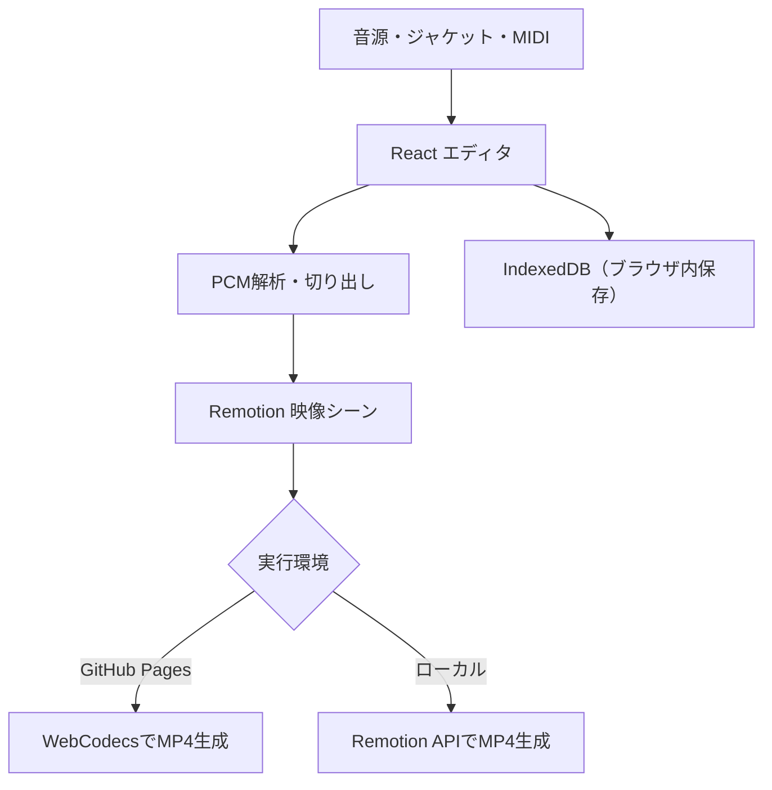

# SONOTYPE

**音楽を、短い縦型映像に。**

YouTube Shorts・Instagram Reels・TikTok向けの音楽ビジュアル動画を、ブラウザで編集・書き出しできる個人開発Webアプリです。音源とテンプレートを選び、曲名・配色・使用区間を調整してMP4を生成できます。

**[Webアプリを試す](https://roki0i.github.io/oto-signal-studio/)** · **[編集画面を開く](https://roki0i.github.io/oto-signal-studio/#editor)** · **[8秒の完成動画を見る](https://roki0i.github.io/oto-signal-studio/sonotype-demo.mp4)**

[](https://github.com/Roki0i/oto-signal-studio/actions/workflows/ci.yml)
[](https://github.com/Roki0i/oto-signal-studio/actions/workflows/pages.yml)

## 使い方

**音源を用意しなくても試せます。** 初期状態でオリジナルのデモ音源が設定されています。

1. 「動画をつくる」から編集画面に進む。
2. 5種類のスタイルを選び、必要に応じて音源・ジャケット画像・曲名・配色を変更する。波形から使用区間も選択できる。
3. 「MP4を書き出す」を押す。対応ブラウザでは端末内で動画を生成する。

[完成動画のサンプル（8秒・540×960・MP4）](https://roki0i.github.io/oto-signal-studio/sonotype-demo.mp4)は、同梱のオリジナルデモ音源からGitHub Actionsで生成したものです。通常の編集画面で書き出す動画は**1080×1920・30fps・H.264/AAC**です。

## 主な機能

- **音楽に反応する5種類のテンプレート**：Signal Lab / Retro Grid / After Hours / Cover Flow / Dopa Rush
- **音声解析**：PCMからフレーム単位で音量（RMS）と周波数帯（FFT）を計測。MIDIファイルの読み込みにも対応
- **切り出し**：波形を見ながら1秒単位で開始位置を指定。動画尺は8秒・15秒・30秒
- **プレビューと出力**：Remotionの同じ映像コンポーネントを使用
- **ブラウザ内保存**：1作品の設定・音源・画像をIndexedDBへ保存・復元

## 技術構成と設計

| 領域 | 技術 | 選定・実装のポイント |
| --- | --- | --- |
| UI | React / TypeScript / Vite | テンプレート・編集画面の状態を管理 |
| 映像 | Remotion | プレビューとレンダリングで映像シーンを共通化 |
| 音声 | Web Audio API / FFT / MIDI | 音源をデコードし、映像の30fpsに合わせて解析 |
| 公開Web版 | WebCodecs / `@remotion/web-renderer` | 専用の動画生成サーバーを置かず、ブラウザ内でMP4を出力 |
| ローカル版 | Remotion / ループバックAPI | 同じ編集データを使ってローカルで書き出し |
| 保存 | IndexedDB | アカウント不要。素材と設定は利用したブラウザ内に保持 |
| 品質確認 | GitHub Actions / Playwright / FFprobe | ブラウザ操作、保存・復元、映像・音声コーデックと同期を検証 |



公開サイトはGitHub Pagesでホスティングしています。**音源・画像をSONOTYPE専用の動画生成サーバーに送信しません。** ただし、Remotionなどのライブラリによるテレメトリ通信が発生する場合があります。

## ローカル実行・検証

Node.js 24推奨、Python 3、ローカル動画生成の確認にはFFmpegが必要です。

```bash
cd apps/studio
npm ci
npm run dev
```

編集画面：`http://127.0.0.1:5173/`

```bash
# apps/studio で実行
npm run build          # TypeScript検証・Viteビルド
npm run render:demo    # ローカルのデモMP4生成
npm audit --audit-level=high
```

GitHub Actionsの[CI](https://github.com/Roki0i/oto-signal-studio/actions/workflows/ci.yml)では、単体テスト・Linux Chromium・Windows Chrome/Edge・ブラウザ内MP4書き出し・音声同期を確認しています。公開ビルドは[Pagesワークフロー](https://github.com/Roki0i/oto-signal-studio/actions/workflows/pages.yml)で検証・配信します。

## 制限と注意事項

- 音源：WAV / MP3 / M4A / AAC / OGG（最大25MiB、長さ1時間以内）。画像：PNG / JPEG / WebP（最大5MiB）。MIDI：最大5MiB。
- ブラウザや端末性能によりMP4の書き出しができない場合があります。**スマートフォンでのMP4出力は未保証**です。
- 保存データは利用したブラウザ内だけに保持されます。サイトデータの削除・ストレージ制限で失われる可能性があり、別端末同期はできません。
- 他者の音源や画像を使用する場合は、公開・投稿に必要な利用権を確認してください。
- Remotionの商用利用では[ライセンス条件](https://github.com/remotion-dev/remotion/blob/main/LICENSE.md)を確認してください。

### リポジトリ構成

`apps/studio/src/` が現行のReactエディタ、`apps/studio/src/remotion/` が映像シーン、`tests/` がE2E・回帰テストです。

ルート直下の`server.py`・`index.html`・`src/`は初期のPython/Canvas版です。現行サイトでは使用していませんが、旧版の回帰テストが参照するため残しています。既存の`OTO-*`コンポジションIDや一部内部識別子も、互換性を維持する目的で変更していません。
